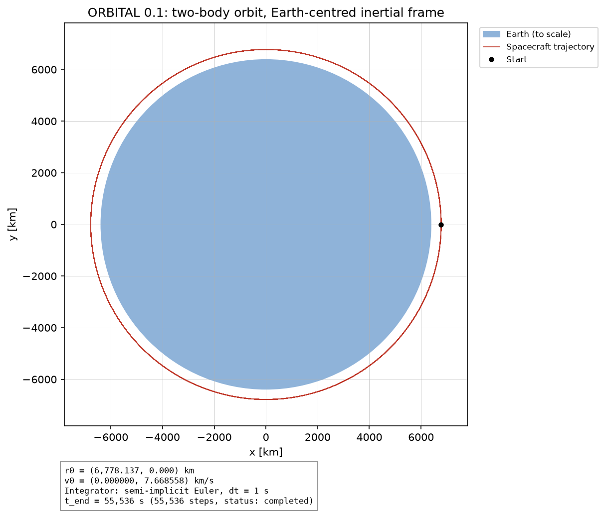

# ORBITAL 0.1 — Validation Report: Circular Reference Orbit

| | |
| --- | --- |
| **Result** | **Pass.** All acceptance metrics T3–T8 are within their accepted tolerances. |
| **Code validated** | Commit `dcaf079` (clean working tree) |
| **Date** | 2026-11-23 |
| **Run by** | Harshith Vaibhav, on his own machine (record below) |
| **Requirements** | [`docs/requirements-0.1.md`](../requirements-0.1.md), rev 3 |
| **Decisions** | [ADR-0001](../decisions/ADR-0001-toolchain-and-core-boundary.md), [ADR-0002](../decisions/ADR-0002-frame-units-state.md) |

## 1. Objective

Show, with quantitative evidence, that ORBITAL's fixed-step semi-implicit Euler propagator reproduces the analytical two-body solution for a circular orbit, within the tolerances accepted in the 0.1 requirements. The checks cover conservation, boundedness, timing, position and convergence order.

## 2. Model and method

- **Physical model (ADR-0002):** idealised 2D Earth-centred inertial frame. Earth is a point mass fixed at the origin, and all other forces are neglected. SI units, float64.
- **Reference case (Requirements §1):** circular orbit at 400 km altitude, starting on the +x axis and moving counter-clockwise. v₀ = √(μ/r₀) is computed in float64, never typed in.
- **Integrator:** semi-implicit (symplectic) Euler: v ← v + Δt·a(r), then r ← r + Δt·v.
- **Run:** Δt = 1 s for 10 analytical periods, converted to a whole number of steps by `steps_for_duration` (F4). For T8, the same orbit is also run at Δt = 10 s.
- **Exact solution used for comparison:** r(t) = r₀ (cos ωt, sin ωt), ω = 2π/T, T = 2π√(r₀³/μ). It is evaluated at the sample times t_k = k·Δt actually reached, never at the requested duration (ADR-0002 §2.6).
- **Measurement:** `scripts/first_orbit.py` computes every metric and prints this record. The same checks run as automated tests in `tests/test_circular_orbit.py`.

## 3. Reproducibility record

| Item | Value |
| --- | --- |
| μ_E | 3.986004418 × 10¹⁴ m³/s² (WGS 84, NGA.STND.0036) |
| R_E | 6,378,137.0 m (WGS 84 semi-major axis) |
| r₀ | (6,778,137.0, 0.0) m |
| v₀ | (0.0, 7,668.5581754071) m/s |
| Integrator, Δt | Semi-implicit Euler, 1 s |
| Requested duration | 55,536.242713 s (10 × T) |
| Steps, t_end, status | 55,536 steps, t_end = 55,536.0 s, `completed` |
| Runtime | 0.57 s (N4 limit: 10 s) |
| Software | Python 3.12.16, NumPy 2.5.5, Matplotlib 3.11.2, orbital 0.1.0.dev0 |
| Commit | `dcaf079`, working tree clean |
| Platform | Apple Silicon Mac (arm64), macOS 26.6.2 |
| Automated tests at this commit | 166 passed |

**To reproduce:**

```bash
git checkout dcaf079
python3.12 -m venv .venv && source .venv/bin/activate
python -m pip install -e ".[dev]"
python scripts/first_orbit.py
pytest -q
```

## 4. Results

| ID | Metric | Measured | Tolerance | Planning pre-check | Result |
| --- | --- | --- | --- | --- | --- |
| T3 | max \|Δh/h₀\| over 10 orbits | 8.66 × 10⁻¹⁵ | ≤ 10⁻¹⁰ | 6.9 × 10⁻¹⁵ | Pass |
| T4 | max \|Δr\|/r₀ over 10 orbits | 5.663 × 10⁻⁴ (3.84 km) | ≤ 10⁻³ | 5.66 × 10⁻⁴ | Pass |
| T4 | max in orbit 10 ÷ max in orbit 1 | 1.00 | ≤ 1.1 | — | Pass |
| T5 | max \|Δε/ε₀\| over 10 orbits | 1.28 × 10⁻⁶ | ≤ 10⁻⁵ | 1.28 × 10⁻⁶ | Pass |
| T5 | max in orbit 10 ÷ max in orbit 1 | 1.00 | ≤ 1.1 | — | Pass |
| T6 | \|t* − T\|/T, first period | 9.067 × 10⁻⁷ | ≤ 10⁻⁵ | 9.1 × 10⁻⁷ | Pass |
| T7 | Position error after 5,553 steps | 38.71 m | ≤ 100 m | 38.7 m | Pass |
| T7 | Position error after 55,536 steps | 386.1 m | recorded, not gated | 386 m | — |
| T8 | Radius-error ratio, Δt = 10 s ÷ Δt = 1 s | 10.1 | 9 to 11 | 10.1 | Pass |

Acceptance tests T1, T2 and T9–T12 (gravity, single step, input checks, impact, plot integrity, core boundary) also pass at this commit, as part of the 166 automated tests.

**Tolerance status.** The requirements called every tolerance provisional until reproduced by the implementation. All measured values reproduce the planning pre-check, which was computed independently before any ORBITAL code existed. The accepted tolerances are therefore now supported by measurement, with these margins:

| Test | T3 | T4 | T5 | T6 | T7 | T8 |
| --- | --- | --- | --- | --- | --- | --- |
| Margin (tolerance ÷ measured) | ~10⁴ | 1.8 | 7.8 | 11 | 2.6 | in range |

No tolerance was changed after measurement.

## 5. Interpretation

1. **Angular momentum is conserved to roundoff.** For a central force, semi-implicit Euler conserves h exactly in real arithmetic (proof in `semi_implicit_euler_step`). The measured 8.7 × 10⁻¹⁵ is floating-point roundoff accumulated over 55,536 steps.
2. **Radius and energy errors are bounded, not drifting.** Their largest deviation in orbit 10 equals that in orbit 1. They oscillate within a fixed band (±3.8 km in radius) instead of accumulating. This is the expected long-term behaviour of a symplectic method. A non-symplectic method such as explicit Euler drifts steadily instead.
3. **Position error grows linearly: a phase error.** The spacecraft stays on almost exactly the right circle, but runs about 5 ms per orbit behind schedule (T6). The along-track position error therefore grows by about 39 m per orbit (38.7 m → 386 m over 10 orbits). Good conservation does not imply accurate timing. T6 and T7 are what measure the difference.
4. **The method is first order.** A 10× larger timestep gives a 10.1× larger radius error, matching the theoretical order of 1.

## 6. Evidence that the tests detect real errors (deliberate-bug checks)

During development, each part of the code was deliberately broken in a scratch copy, to confirm the tests catch the fault. The most informative results:

| Deliberate bug | Caught by |
| --- | --- |
| Integrator changed to explicit Euler (position uses the old velocity) | T2, T3, T4, T5, T6, T7, T8 and the one-step angular-momentum tests |
| Gravity 0.01% too strong (a wrong constant) | **T6, T7, T8 only** |
| Force law r^−2.00001 instead of r^−2 | **T6, T7, T8 only** |
| Impact check removed | T10 |
| Floating-point snap in `steps_for_duration` removed | F4 case-table test |
| Period detection without interpolation | `first_period` unit tests |
| Plotted y-coordinate left in metres | T11 |

The wrong-constant and wrong-force-law rows matter most. Both bugs leave the simulation **self-consistent**: angular momentum is still conserved, and the orbit still looks circular and stable, so T3–T5 pass. Only the comparisons against an independent analytical answer (T6–T8) catch them. Conservation checks alone cannot establish correctness.

## 7. Cross-platform check

The same commit's code was also run by Claude on x86_64 Linux (Ubuntu 24.04): Python 3.12.3 with NumPy 2.5.5, and Python 3.11.18 with NumPy 2.4.6. All metrics agreed with the table above to four significant figures, except T3: 1.09 × 10⁻¹⁴ on x86_64 Linux versus 8.66 × 10⁻¹⁵ on arm64 macOS. T3 measures pure roundoff, which depends on the processor and math library, so this difference is expected. Requirement I3 promises bit-identical results only on the same platform and library versions. Both values are about 10⁴ below the tolerance.

## 8. Limitations

- **One case.** Validated for a single circular orbit at 400 km. Elliptical orbits, other altitudes and the full validity range of Δt are untested (0.2, 0.3).
- **Idealised physics.** Point-mass Earth only: no J2 oblateness, drag, third bodies or radiation pressure, and 2D only (ADR-0002). Results do not predict real spacecraft, such as the ISS, which experience drag.
- **First-order integrator.** The along-track error grows linearly with time (about 39 m per orbit at Δt = 1 s), so long propagations accumulate timing error. Higher-order methods are compared in 0.2.
- **T8 uses two timesteps.** That confirms first-order behaviour, but it is not a full convergence study (0.2).
- **Impact time is approximate.** Impact is detected at step boundaries only (ADR-0002 §2.7). It is not part of this validation.
- **The plot is not evidence.** At plot scale the 3.8 km radius band is far below one pixel. The figure illustrates the run; it does not validate it.

## 9. Figure



Produced by `python scripts/first_orbit.py` at commit `dcaf079` on the machine recorded in §3.

## 10. Conclusion

At commit `dcaf079`, ORBITAL's two-body propagator meets every 0.1 acceptance criterion for the circular reference orbit. Angular momentum is conserved to roundoff, radius and energy errors are bounded, and the period, position and convergence order agree with the analytical solution within the accepted tolerances. These conclusions hold within the limitations in §8.
